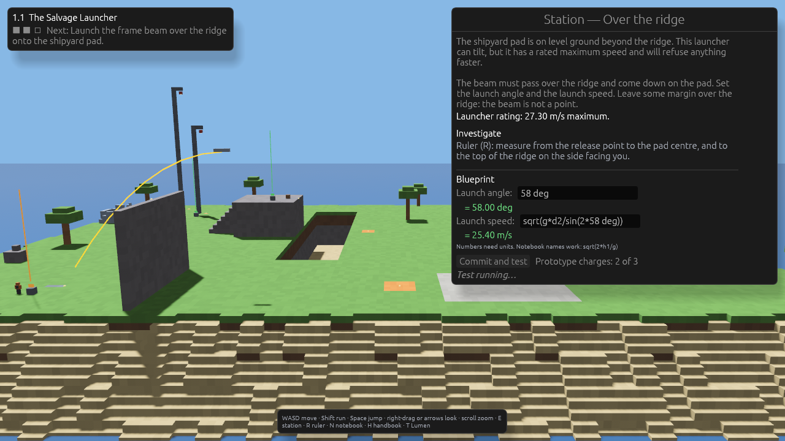

# First Principles

A physics game. You are stranded on a block planet and build a ship, part by part; every part is earned
by doing the physics it depends on. Measure the world, work out the values, commit, and see whether the
world agrees. The ship's computer, Lumen, can explain anything and touch nothing.

This repository holds the design and a playable slice: tier 1, chapter 1 (kinematics, three puzzles).



## Run

Needs Rust 1.97.1 or newer. The first build takes a while (the engine is large).

```bash
cargo run -p game
```

WASD move · Shift run · Space jump · right-drag or arrow keys look · scroll zoom ·
E use a station · R ruler · N notebook and calculator · H handbook · T Lumen

Progress is saved to `saves/slot1.ron`. Delete it to start over on a new planet (new numbers).

### Lumen (optional)

Copy `settings.example.toml` to `settings.toml`, fill in a service and model, and set the environment
variable it names. No model vendor is built in; see [docs/tutor.md](docs/tutor.md).

## Test

```bash
cargo test --workspace
```

Two scripted runs drive the real game and fail loudly if something is off:

```bash
GAME_SCRIPT=tour GAME_SEED=7 GAME_SAVE=/tmp/fp-tour.ron cargo run -p game
```

```bash
GAME_SCRIPT=walk GAME_SEED=7 GAME_SAVE=/tmp/fp-walk.ron cargo run -p game
```

`tour` plays the chapter with the expressions a player would type and writes screenshots to `shots/`;
`walk` drives the avatar by key presses over steps, a drop and a jump.

## Layout

| Path | What |
|---|---|
| `docs/` | game design, curriculum, tutor, architecture |
| `crates/physics_core` | units, calculator, exact simulators, puzzles, save — no engine |
| `crates/tutor` | read-only tutor: snapshot, prompt, leak filter, provider adapter — no engine |
| `game` | the Bevy application |
| `assets/curriculum` | chapter text as data |
