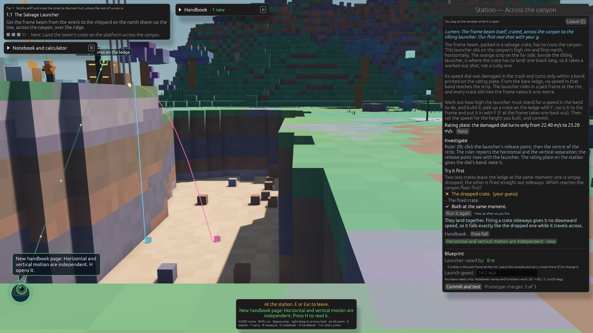

# First Principles

A physics game. You are stranded on a block planet and build a ship, part by part; every part is earned
by doing the physics it depends on. Measure the world, work out the values, commit, and see whether the
world agrees. The ship's computer, Lumen, can explain anything and touch nothing.

This repository holds the design and a playable slice: tier 1, chapter 1 (kinematics: a tutorial and three puzzles).


Each station starts with an experiment to try before any calculation. You guess what will happen,
then watch: a crate dropped and a crate fired sideways reach the canyon floor together. What you see
writes the matching page of your handbook (H), and the stations point you to the pages they need.



## Run

Needs Rust 1.97.1 or newer. The first build takes a while (the engine is large).

```bash
cargo run -p game
```

The game opens on the title menu, with the intro playing behind it: how the castaway's ship broke up
and came down, seen from orbit, over the mainland and on the island. Start (or Enter) begins.


WASD move · Shift run · Space jump · right-drag or arrow keys look · scroll zoom ·
E use a station · R ruler · N notebook and calculator · H handbook · T (or click the eye) Lumen

Progress is saved to `saves/slot1.ron`. Delete it to start over on a new planet (new numbers).

### Lumen

Lumen, the ship's computer, is the eye in the lower left. It points at what to do next with a beam of
light and comments on your tests, with or without a language model.


To talk to it, copy `settings.example.toml` to `settings.toml`, fill in a service and model, and set the environment
variable it names. No model vendor is built in; see [docs/tutor.md](docs/tutor.md).

## Test

```bash
cargo test --workspace
```

Three scripted runs drive the real game and fail loudly if something is off:

```bash
GAME_SCRIPT=tour GAME_SEED=7 GAME_SAVE=/tmp/fp-tour.ron cargo run -p game
```

```bash
GAME_SCRIPT=walk GAME_SEED=7 GAME_SAVE=/tmp/fp-walk.ron cargo run -p game
```

```bash
GAME_SCRIPT=intro GAME_SEED=7 GAME_SAVE=/tmp/fp-intro.ron cargo run -p game
```

`tour` plays the chapter with the expressions a player would type and writes screenshots to `shots/`;
`walk` drives the avatar by key presses over steps, a drop and a jump; `intro` photographs the intro,
presses Start and checks that the game takes over. `tour` and `walk` press Start first.

## Layout

| Path | What |
|---|---|
| `docs/` | game design, curriculum, tutor, architecture |
| `crates/physics_core` | units, calculator, exact simulators, puzzles, save — no engine |
| `crates/tutor` | read-only tutor: snapshot, prompt, leak filter, provider adapter — no engine |
| `game` | the Bevy application |
| `assets/curriculum` | chapter text as data |
