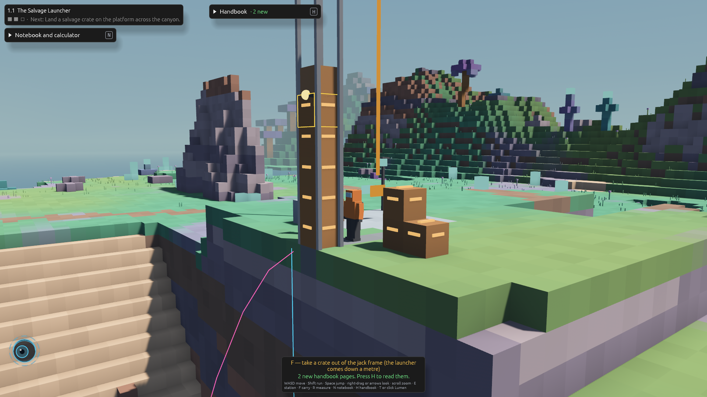

# First Principles

A physics game. You are stranded on a block planet and build a ship, part by part; every part is earned
by doing the physics it depends on. Measure the world, work out the values, commit, and see whether the
world agrees. The ship's computer, Lumen, can explain anything and touch nothing.

This repository holds the design and a playable slice: tier 1, chapter 1 (kinematics: a tutorial and four puzzles).


Each station starts with an experiment to try before any calculation. You guess what will happen,
then watch: a crate dropped and a crate fired sideways reach the canyon floor together. What you see
writes the matching page of your handbook (H), and the stations point you to the pages they need.


## Run

Needs Rust 1.97.1 or newer. The first build takes a while (the engine is large).

```bash
cargo run -p game
```

The game opens on the title menu, with the intro playing behind it: how the castaway's ship broke up
and came down, seen from orbit, over the mainland and on the island. Start (or Enter) begins.


WASD move · Shift run · Space jump · right-drag or arrow keys look · scroll zoom ·
E use a station (E or Esc leaves) · F pick up and put down · R measure once with the ruler ·
N notebook and calculator · H handbook · T (or click the eye) Lumen. N, H and T expand and reduce panels
that stay on screen.

Some things are done with your hands. The supply rail's cart will not run until you have carried its
cargo crate onto it. On the haul track a survey crawler runs at one steady speed you can only
measure: time it between two posts, then set the haul cart's speed so it catches the crawler on the
transfer marker. At the drop tower you can clamp a light gate at any metre of the tower and time
the fall to it, short drops and long. At the canyon the launcher's dial only turns within a band, too
slow for the bare ledge: work out how high it must stand, carry salvage crates into the jack frame
under it (one metre each), then set the speed for the height you built.



Progress is saved to `saves/slot1.ron`. Delete it to start over on a new planet (new numbers).

### Lumen

Lumen, the ship's computer, is the eye in the lower left: or what is left of it on the island, a
backup whose core lies in the main hull across the strait. The skiff you build in tier 1 is how the
two of you get there. Lumen points at what to do next with a beam of light, says why each station
matters, comments on your tests and, now and then, on where you are, with or without a language model.


To talk to it, copy `settings.example.toml` to `settings.toml`, fill in a service and model, and set the environment
variable it names. No model vendor is built in; see [docs/tutor.md](docs/tutor.md).

## Test

```bash
cargo test --workspace
```

Three scripted runs drive the real game and fail loudly if something is off:

```bash
GAME_SCRIPT=tour GAME_SEED=7 GAME_SAVE=/tmp/fp-tour.ron cargo run -p game
```

```bash
GAME_SCRIPT=walk GAME_SEED=7 GAME_SAVE=/tmp/fp-walk.ron cargo run -p game
```

```bash
GAME_SCRIPT=intro GAME_SEED=7 GAME_SAVE=/tmp/fp-intro.ron cargo run -p game
```

```bash
GAME_SCRIPT=pose GAME_SEED=7 GAME_SAVE=/tmp/fp-pose.ron cargo run -p game
```

`tour` plays the chapter with the expressions a player would type, loads the rail cart, times the
crawler and catches it (once too soon, once on the marker), times drops
with the light gate at two notches, carries the canyon's crates into the jack frame, and writes
screenshots to `shots/`;
`walk` drives the avatar by key presses over steps, a drop and a jump; `intro` photographs the intro,
presses Start and checks that the game takes over; `pose` films the avatar's animations up close
(standing, walking, running, jumping, carrying a crate, at a console, watching a test, a miss and a
pass). `tour`, `walk`
and `pose` press Start first.

## Layout

| Path | What |
|---|---|
| `docs/` | game design, curriculum, tutor, architecture |
| `crates/physics_core` | units, calculator, exact simulators, puzzles, save — no engine |
| `crates/tutor` | read-only tutor: snapshot, prompt, leak filter, provider adapter — no engine |
| `game` | the Bevy application |
| `assets/curriculum` | chapter text as data |
