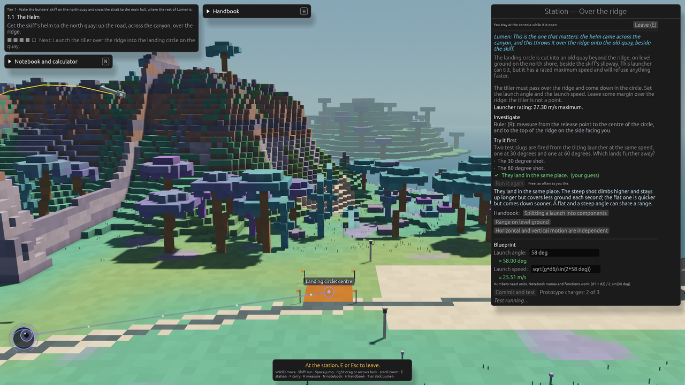
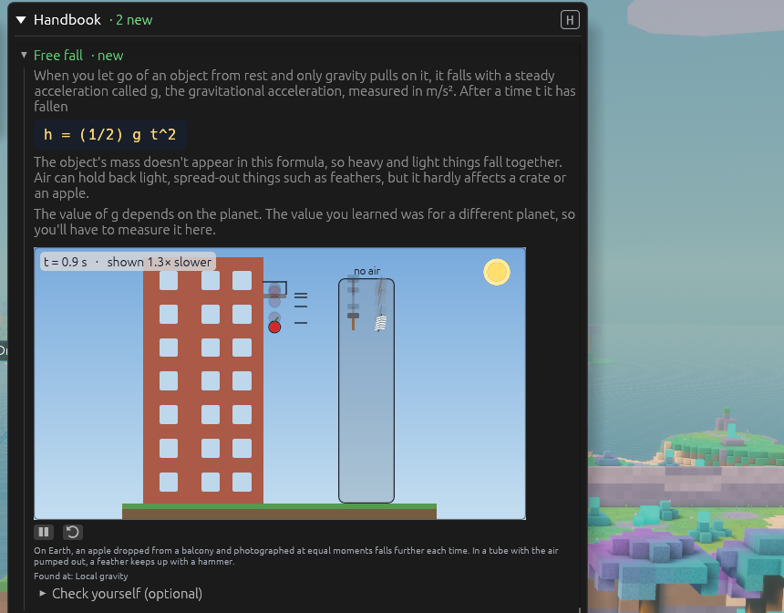
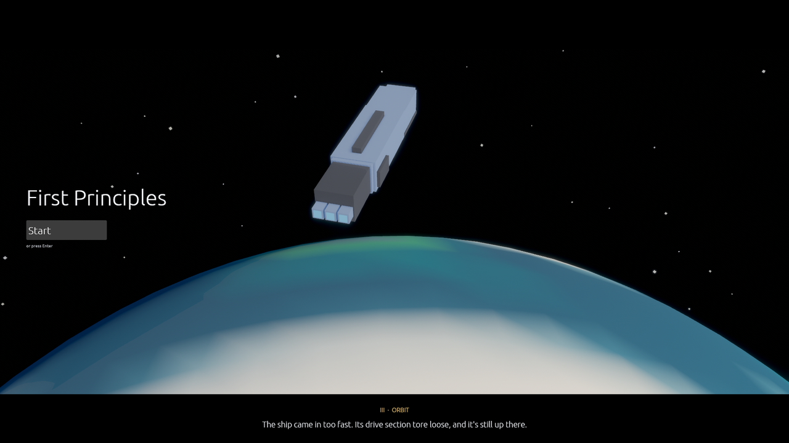
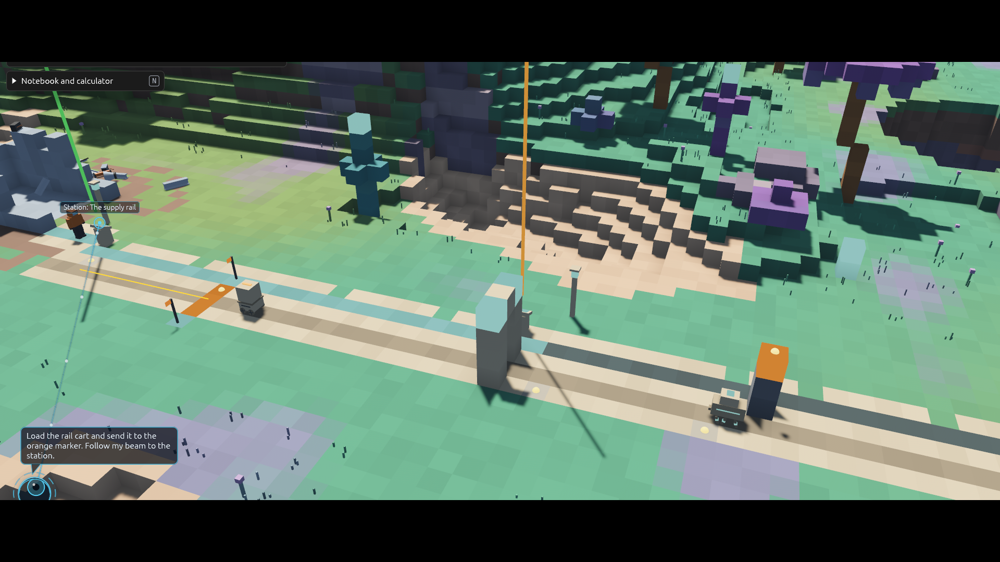
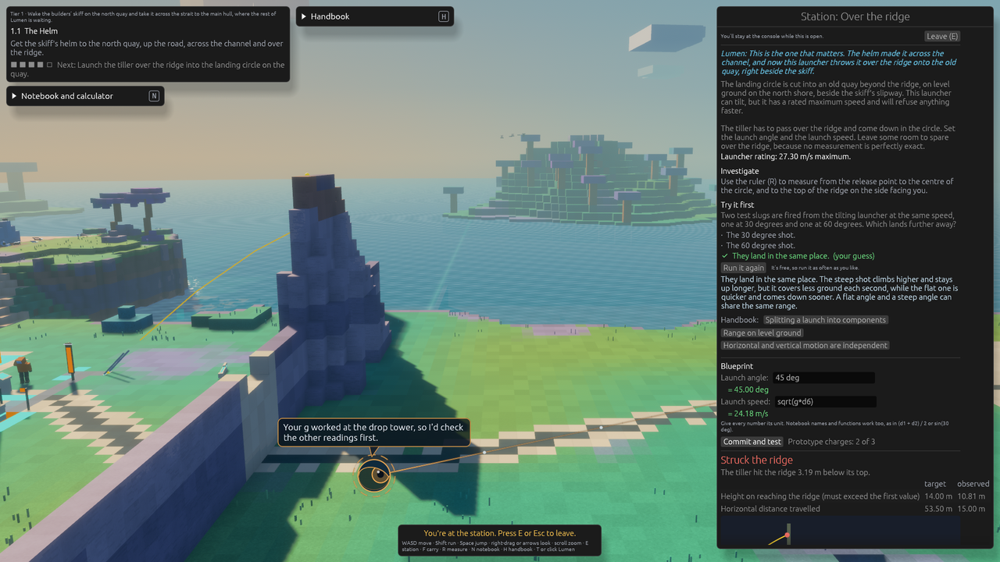

# First Principles

A physics game. You are stranded on a block planet, beside an ancient road whose machines are
asleep, and wake the skiff they left on its slipway, part by part; every part is earned by doing the
physics it depends on.
Measure the world, work out the values, commit, and see whether the world agrees.
The ship's computer, Lumen, can explain anything and touch nothing.

This repository holds the design and a playable slice: tier 1, chapter 1 (kinematics: a tutorial and four puzzles).



Each station starts with an experiment to try before any calculation. You guess what will happen,
then watch: a block dropped and a block fired sideways reach the water together. What you see
writes the matching page of your handbook (H), and the stations point you to the pages they need.


Each handbook page shows its idea in a short looping picture set on Earth: a cyclist past distance
posts, an apple dropped from a balcony, two kicks landing on one flag. Pause and replay are under it.
An optional quiz checks the page has sunk in. Answer every question right and the page gets a tick.
The quizzes change nothing in the world.



## Run

Needs Rust 1.97.1 or newer. The first build takes a while (the engine is large).

```bash
cargo run -p game
```

The game opens on the title menu, with the intro playing behind it: how the castaway's ship broke up
and came down, seen from orbit, over the mainland and on the island. Start (or Enter or Space) begins.



WASD move · Shift run · Space jump · right-drag or arrow keys look · scroll zoom ·
E use a station (E or Esc leaves) · F pick up and put down · R measure once with the ruler ·
N notebook and calculator · H handbook · T (or click the eye) Lumen. N, H and T expand and reduce panels
that stay on screen.

The road's machines sleep at the start. Each pass wakes the next one: a light runs up the road's
quartz to it, it stirs (a gate opens, a ramp of steps rises, a beam reaches across the strait), and
its own console and lamp light with it. E or Esc skips the scene.



Some things are done with your hands. The supply rail's cart will not run until you have carried its
block onto it. On the haul track the road builders' crawler walks at one steady speed you can only
measure: time it between two posts, then set the haul cart's speed so it catches the crawler on the
transfer marker. At the drop tower you can clamp a light gate at any metre of the tower and time
the fall to it, short drops and long. At the channel between the islands the launcher's dial only turns within a band, too
slow for the bare ledge: work out how high it must stand, carry the builders' stone blocks into the jack frame
under it (one metre each), then set the speed for the height you built.


Progress is saved to `saves/slot1.ron`. Delete it to start over on a new planet (new numbers).

### Lumen

Lumen, the ship's computer, is the eye in the lower left: or what is left of it on the island, a
backup whose core lies in the main hull across the strait. The builders' skiff, woken in tier 1, is how
the two of you get there. Lumen points at what to do next with a beam of light, says why each station
matters, comments on your tests and, now and then, on where you are, with or without a language model.
When it has something to say it comes forward to the bottom centre of the screen, and goes back to
its corner after.



To talk to it, copy `settings.example.toml` to `settings.toml`, fill in a service and model, and set the environment
variable it names. No model vendor is built in; see [docs/tutor.md](docs/tutor.md).

The same file sets the graphics: `quality = "low"` (the default, for integrated graphics) or `"high"`
(ambient occlusion, sharper shadows, a finer edge filter) under `[graphics]`.

## Test

```bash
cargo test --workspace
```

Five scripted runs drive the real game and fail loudly if something is off:

```bash
GAME_SCRIPT=tour GAME_SEED=7 GAME_SAVE=/tmp/fp-tour.ron cargo run -p game
```

```bash
GAME_SCRIPT=walk GAME_SEED=7 GAME_SAVE=/tmp/fp-walk.ron cargo run -p game
```

```bash
GAME_SCRIPT=intro GAME_SEED=7 GAME_SAVE=/tmp/fp-intro.ron cargo run -p game
```

```bash
GAME_SCRIPT=pose GAME_SEED=7 GAME_SAVE=/tmp/fp-pose.ron cargo run -p game
```

```bash
GAME_SCRIPT=way GAME_SEED=7 GAME_SAVE=/tmp/fp-way.ron cargo run -p game
```

`tour` plays the chapter with the expressions a player would type, loads the rail cart, times the
crawler and catches it (once too soon, once on the marker), times drops
with the light gate at two notches, photographs each handbook page as it is found and answers the
Free fall page's quiz (once wrong, then right), carries the ledge's blocks into the jack frame, and writes
screenshots to `shots/`;
`walk` drives the avatar by key presses over steps, a drop and a jump; `intro` photographs the intro,
presses Start and checks that the game takes over; `pose` films the avatar's animations up close
(standing, walking, running, jumping, carrying a block, at a console, watching a test, a miss and a
pass); `way` photographs each of the way's machines asleep in a new game, then with every puzzle
solved. All but `intro` press Start first.

`look` is the benchmark for how the game looks and how fast it draws. It photographs the same views
every time (each of the way's machines asleep and awake, the whole island, the ringed giant, the
first wake as its light runs) and times the frames at each while the camera turns slowly, with vsync
off so the numbers are the drawing's and not the screen's refresh rate. The frame rates go to
`look.txt` beside the shots, so two versions can be compared picture by picture and
number by number. Build with `--release` for numbers worth comparing.

```bash
GAME_SCRIPT=look GAME_SEED=7 GAME_SAVE=/tmp/fp-look.ron cargo run --release -p game
```

To play by hand without the bookkeeping, `prefill` puts the tour's ruler readings in the notebook
and keeps each station's blueprint (and the calculator, at the haul track and the channel) filled
with the tour's formula. A formula appears once the readings it needs exist: the chase waits for
the crawler's stopwatch time, gravity for a light gate reading, the channel and the ridge for the
calibrated `g`. Walking, carrying, running experiments and committing stay yours. Type over a
blueprint and it is left alone; clear it to get the formula back.

```bash
GAME_SCRIPT=prefill GAME_SEED=7 GAME_SAVE=/tmp/fp-prefill.ron cargo run -p game
```

## Layout

| Path | What |
|---|---|
| `docs/` | game design, curriculum, tutor, architecture |
| `crates/physics_core` | units, calculator, exact simulators, puzzles, save — no engine |
| `crates/tutor` | read-only tutor: snapshot, prompt, leak filter, provider adapter — no engine |
| `game` | the Bevy application |
| `assets/curriculum` | chapter text as data |
